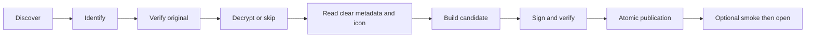

# Build pipeline and maintenance

Python 3.12+ orchestrates the native macOS bundle. Inputs are the player's
card image, optional key sources, the pinned zakuro host and an installed
3dsrecomp AOT library. ROMs, keys and generated game assets never belong in git.

## Reproducible native tools

`vendors.lock.json` records upstream revisions and expected patched Git trees.
Run `python3 scripts/bootstrap_vendors.py` in a fresh checkout, then:

```sh
rustup toolchain install 1.99.1 --profile minimal
cargo +1.99.1 build --manifest-path vendors/zakuro/Cargo.toml --release --locked
cargo +1.99.1 build --manifest-path vendors/3dsrecomp/Cargo.toml --release --locked
```

The bootstrap never resets an existing checkout. `--verify-only` checks it.
Changes to the ignored fork are committed there and exported into the numbered
patch series; update the locked tree when adding a patch. Rebuild the host
before building apps that depend on the new `--language` interface.

## Stages

Every run reports the same seven stages, numbered 1 through 7:

1. **discover** — bounded classification of `.3ds`, `.3dz` and `.cci` inputs.
   CIA is recognized but cannot be packaged.
2. **identify** — validate the NCSD/NCCH headers and resolve the title profile.
3. **verify the dump** — stream the original dump's profile MD5, unless skipped
   explicitly. The original path remains the identity of the build.
4. **decrypt a working copy** — skip for NoCrypto; otherwise validate every
   partition and publish a verified temporary copy atomically. Metadata and
   icon reads subsequently use this copy and its newly parsed partition.
5. **make the icon** — decode SMDH, or skip with `--no-icon`. Truncated SMDH is
   an error; a complete SMDH without titles uses `Game` as the app name.
6. **pack the app** — assemble a fresh candidate beside the destination, sign
   each executable and the bundle, verify signatures, then publish atomically.
7. **verify the app** — with `--launch`, run the bundled host headlessly before
   opening the app. Nonzero exit, timeout or an unsuccessful smoke stops opening.



## Crypto contract

`--boot9` accepts retail full (64 KiB) and protected-region (32 KiB) dumps and
extracts the original NCCH slot. `--keys` supplies `slot=hexkey` rows, including
additional slots required by newer crypto methods. Both may be used together;
conflicting entries fail. FixedKey applications require neither. Seeded NCCH
and FixedKey system titles remain unsupported and fail explicitly.

Partitions/regions/sections must fit their containing ranges and not overlap.
ExeFS entries are processed by offset, independently of table order. Alignment
padding, original-key sections, content-key sections and hashes are handled
separately; bad keys never publish a replacement copy. AES uses `cryptography`
when installed and the system OpenSSL fallback otherwise.

## Publication, reuse and player data

The versioned content key covers the ROM actually loaded (original or verified working copy),
source host/AOT/hints, effective launcher, icon pixels, metadata, scale,
language and destination paths. Reuse additionally checks required files and
real signatures. Older keys cause one rebuild.

The key is written into the **candidate before signing**. It becomes visible
at the final destination only when the signed, verified bundle is published.
Existing directories are exchanged atomically on macOS. A failed copy, signing
or verification leaves the previous app intact.

The sibling `<game>.app.ctr-native/` is player data. Builds never write player
settings. Legacy migration preflights collisions and activity, copies only
absent files, and retains the previous bundle at
`<game>.app.ctr-native-legacy/`. A collision requires manual resolution; neither
copy is overwritten. If archiving fails after publication, the error names the
retained recovery bundle; it is not deleted.

The launcher exports HOME into that sandbox, passes scale and language
(defaults 3 and `en`) as execution overrides, and points at the bundle's own
host/AOT copies and the external ROM. Settings remain owned by the runtime.

## Reporting and tests

`--progress json` writes one JSON event per stdout line: `stage`, `step`,
`progress`, `stage_end`, `say`. Events carry `k`/`n`; successful runs finish at
7/7 and failures close their current stage with `ok:false`. `auto` chooses bars
on a TTY and lines behind a pipe. `off` keeps stage summaries only.

Build metadata is recorded in `<id>_build/logs/pack.tsv`; the builder does not
promise a separate log file for every stage. Runtime logs live under the
sandbox's `home/Library/Application Support/zakuro/`. Vulkan caches live under
`home/Library/Caches/zakuro/pipelines/`.

```sh
python3 -m unittest discover -s dm/tests -t . -p 't_*.py' -v
python3 -m dm.tests.fuzz_containers --iterations 2000
ruff check dm scripts
```

Tests manufacture their inputs, including AES ciphertext and native host code.
The macOS smoke actually builds icons, signs a bundle, verifies it, reuses it,
rebuilds it and executes its launcher. CI also reconstructs and tests the
patched native workspace. Hardware two-monitor and real audio measurements
are separate from automated synthetic checks; record their results explicitly.

## Shared presentation smoke

The patched host accepts `--test-pattern --test-frames 120`. The diagnostic
manufactures GPU-only color images and exits after a bounded number of frames.
Run `python3 scripts/native_smoke.py` from a logged-in graphical macOS session.
It isolates HOME/data and checks single Vulkan, shared Vulkan, window lifecycle,
Vulkan-to-OpenGL readback and two OpenGL contexts. No game or console data is used.

With installed Khronos validation layers, pass `--validation-layer-dir <directory>`.
The runner enables synchronization validation and fails on validation errors or
missing GPU-sharing evidence, even when the host exit code is zero. The exact
selected GPU image/crop readback also has an ignored-by-default live-GPU Rust
regression; run it explicitly when a Vulkan loader and GPU are available.
